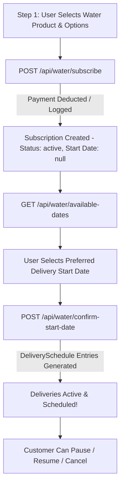

# 💧 Water Subscription System — API Integration Documentation
**Project:** RamBhaji Delivery Platform  
**Target Audience:** Frontend Developers (Web / Mobile Apps)  
**Base URL:** `http://localhost:3000/api` (Local) / `https://<your-production-domain>/api` (Production)  
**Standard Authorization Header:** `Authorization: Bearer <jwt_token>` (or Cookie authentication if credentials enabled)

---

## 📌 Table of Contents
1. [Architecture & Workflow Overview](#1-architecture--workflow-overview)
2. [Prerequisite Endpoints (Master Data)](#2-prerequisite-endpoints-master-data)
   - 2.1 Get Water Products Catalog
   - 2.2 Get User Delivery Addresses
   - 2.3 Add New Delivery Address
   - 2.4 Get Active Delivery Batches (Slots)
3. [Water Subscription Core Endpoints](#3-water-subscription-core-endpoints)
   - 3.1 Purchase / Create Water Subscription (`POST /api/water/subscribe`)
   - 3.2 Get Available Delivery Start Dates (`GET /api/water/available-dates`)
   - 3.3 Confirm Start Date & Generate Schedules (`POST /api/water/confirm-start-date`)
   - 3.4 Get User's Water Subscriptions (`GET /api/water/subscriptions`)
   - 3.5 Pause Water Subscription (`PATCH /api/water/:id/pause`)
   - 3.6 Restart / Resume Water Subscription (`PATCH /api/water/:id/restart`)
   - 3.7 Cancel Water Subscription (`PATCH /api/water/:id/cancel`)
4. [Business Logic & Pricing Formulas](#4-business-logic--pricing-formulas)
5. [Error Handling & Status Codes](#5-error-handling--status-codes)

---

## 1. Architecture & Workflow Overview

The Water Subscription workflow is a **2-step lifecycle**:



---

## 2. Prerequisite Endpoints (Master Data)

Before a user purchases a water subscription, the frontend needs to fetch available products, user addresses, and delivery time batches.

### 2.1 Get Water Products Catalog
Used to populate the Water Plans list (Miracle, Health, Glass, Plastic, Bottle capacity in Liters, and Rate per bottle).

- **Endpoint:** `GET /api/products`
- **Auth Required:** Optional / Public (or Bearer Token)
- **Frontend Filter:** Filter products where `category === "water"` and `status === "active"`.

#### Example Response (200 OK):
```json
{
  "success": true,
  "products": [
    {
      "id": 12,
      "name": "HEALTH 8.0 pH, Alkaline Water (Glass)",
      "hindi_name": "HEALTH 8.0 pH, अल्कलाइन वॉटर (ग्लास)",
      "category": "water",
      "sub_category": "glass",
      "selling_price_per_gm": "67.50",
      "water_capacity_liters": "1.00",
      "unit": "Lt",
      "status": "active"
    },
    {
      "id": 15,
      "name": "MIRACLE 9.5pH, Alkaline Water (Food Grade Plastic)",
      "hindi_name": "MIRACLE 9.5pH, अल्कलाइन वॉटर (प्लास्टिक)",
      "category": "water",
      "sub_category": "plastic",
      "selling_price_per_gm": "44.00",
      "water_capacity_liters": "2.00",
      "unit": "Lt",
      "status": "active"
    }
  ]
}
```

> **Key Fields for Frontend:**
> - `selling_price_per_gm`: Represents the **Price per 1 Bottle** (e.g. ₹67.50).
> - `water_capacity_liters`: Bottle size in Liters (e.g. `1.00` for 1L, `2.00` for 2L).
> - `sub_category`: Container material (`"glass"` or `"plastic"`).

---

### 2.2 Get User Delivery Addresses
- **Endpoint:** `GET /api/addresses`
- **Method:** `GET`
- **Auth Required:** Bearer Token (`user`)

#### Response (200 OK):
```json
{
  "success": true,
  "addresses": [
    {
      "id": 5,
      "user_id": 25,
      "address_line": "Flat 402, Green Meadows",
      "city": "Jaipur",
      "pincode": "302020",
      "landmark": "Near Apex Hospital",
      "is_default": true
    }
  ]
}
```

---

### 2.3 Add New Delivery Address
- **Endpoint:** `POST /api/addresses`
- **Method:** `POST`
- **Auth Required:** Bearer Token (`user`)
- **Headers:** `Content-Type: application/json`

#### Request Payload:
```json
{
  "address_line": "House No. 12, Sunrise Enclave",
  "city": "Jaipur",
  "pincode": "302017",
  "landmark": "Opposite City Mall",
  "is_default": true
}
```

---

### 2.4 Get Active Delivery Batches (Slots)
- **Endpoint:** `GET /api/user/batches` (or `GET /api/batches`)
- **Method:** `GET`
- **Auth Required:** Bearer Token

#### Response (200 OK):
```json
{
  "success": true,
  "batches": [
    {
      "id": 1,
      "name": "Morning Batch",
      "time_range": "06:00 AM - 08:30 AM",
      "status": "active"
    },
    {
      "id": 2,
      "name": "Evening Batch",
      "time_range": "05:00 PM - 07:30 PM",
      "status": "active"
    }
  ]
}
```

---

## 3. Water Subscription Core Endpoints

### 3.1 Purchase / Create Water Subscription
Initiates payment and registers the subscription record in the database.

- **Endpoint:** `POST /api/water/subscribe`
- **Method:** `POST`
- **Auth Required:** Bearer Token (`user`)
- **Headers:** `Content-Type: application/json`

#### Request Payload:
```json
{
  "product_id": 12,
  "water_type": "health",
  "container": "glass",
  "frequency": "daily",
  "type": "monthly",
  "bottles_per_delivery": 2,
  "capacity_liters": 1.00,
  "address_id": 5,
  "batch_id": 1,
  "payment_method": "wallet"
}
```

#### Field Explanations:
| Field | Type | Required | Description |
|---|---|---|---|
| `product_id` | Integer | Recommended | Product ID from catalog |
| `water_type` | String | Yes | `"health"` (pH 8.0) or `"miracle"` (pH 9.5) |
| `container` | String | Yes | `"glass"` or `"plastic"` |
| `frequency` | String | Yes | `"daily"` (30 deliveries/mo) or `"alternate"` (15 deliveries/mo) |
| `type` | String | No | `"monthly"` (default) or `"yearly"` (25% off) |
| `bottles_per_delivery` | Integer | Yes | Number of bottles per delivery (e.g. `1`, `2`, `3`) |
| `capacity_liters` | Float | No | Bottle size in Liters (auto-resolved from product if omitted) |
| `address_id` | Integer | No | Delivery address ID (falls back to user's default address) |
| `batch_id` | Integer | Yes | Selected delivery time batch ID |
| `payment_method` | String | Yes | `"wallet"` or `"razorpay"` |

#### Success Response (201 Created):
```json
{
  "success": true,
  "message": "Water subscription purchased! Please select a start date.",
  "water_subscription_id": 14,
  "amount_charged": 4050.00,
  "wallet_balance": 950.00
}
```

#### Error Responses:
- **400 Bad Request (Insufficient Wallet):**
  ```json
  {
    "success": false,
    "message": "Insufficient wallet balance. Total amount needed: ₹4050.00. Your balance: ₹950.00"
  }
  ```
- **400 Bad Request (Existing Plan):**
  ```json
  {
    "success": false,
    "message": "You already have an active or paused water subscription"
  }
  ```

---

### 3.2 Get Available Delivery Start Dates
Fetches the allowed upcoming dates for starting the delivery schedule (skips Sundays and coordinates with delivery routes).

- **Endpoint:** `GET /api/water/available-dates`
- **Method:** `GET`
- **Auth Required:** Bearer Token (`user`)

#### Success Response (200 OK):
```json
{
  "success": true,
  "available_dates": [
    "2026-10-16",
    "2026-10-17",
    "2026-10-19",
    "2026-10-20",
    "2026-10-21",
    "2026-10-22",
    "2026-10-23"
  ]
}
```

---

### 3.3 Confirm Start Date & Generate Schedules
After selecting the date from the list above, call this endpoint to generate all `DeliverySchedule` entries.

- **Endpoint:** `POST /api/water/confirm-start-date`
- **Method:** `POST`
- **Auth Required:** Bearer Token (`user`)
- **Headers:** `Content-Type: application/json`

#### Request Payload:
```json
{
  "water_subscription_id": 14,
  "start_date": "2026-10-16"
}
```

#### Success Response (200 OK):
```json
{
  "success": true,
  "message": "Start date confirmed and delivery schedules generated",
  "start_date": "2026-10-16",
  "end_date": "2026-11-15",
  "delivery_dates": [
    "2026-10-16",
    "2026-10-17",
    "2026-10-18",
    "..."
  ]
}
```

---

### 3.4 Get User's Water Subscriptions
Fetches all water subscriptions belonging to the logged-in customer along with their generated delivery schedules.

- **Endpoint:** `GET /api/water/subscriptions`
- **Method:** `GET`
- **Auth Required:** Bearer Token (`user`)

#### Success Response (200 OK):
```json
{
  "success": true,
  "water_subscriptions": [
    {
      "id": 14,
      "user_id": 25,
      "water_type": "health",
      "container": "glass",
      "capacity_liters": "1.00",
      "bottles_per_delivery": 2,
      "frequency": "daily",
      "price_per_bottle": "67.50",
      "status": "active",
      "start_date": "2026-10-16",
      "end_date": "2026-11-15",
      "type": "monthly",
      "yearly_amount_paid": null,
      "services_completed": 3,
      "total_services": 30,
      "address_id": 5,
      "batch_id": 1,
      "created_at": "2026-10-15T11:45:00.000Z",
      "Schedules": [
        {
          "id": 102,
          "water_subscription_id": 14,
          "scheduled_date": "2026-10-16",
          "status": "delivered",
          "batch_id": 1
        },
        {
          "id": 103,
          "water_subscription_id": 14,
          "scheduled_date": "2026-10-17",
          "status": "pending",
          "batch_id": 1
        }
      ]
    }
  ]
}
```

---

### 3.5 Pause Water Subscription
Allows the customer to temporarily halt deliveries (e.g. out of town). Pending schedules from today onwards are marked as `skipped`.

- **Endpoint:** `PATCH /api/water/:id/pause`
- **Method:** `PATCH`
- **Auth Required:** Bearer Token (`user`)
- **URL Parameter:** `:id` = `water_subscription_id`
- **Headers:** `Content-Type: application/json`

#### Request Payload:
```json
{
  "pause_days": 5,
  "pause_type": "monthly",
  "pause_scope": "single"
}
```

#### Field Explanations:
| Field | Type | Allowed Values | Description |
|---|---|---|---|
| `pause_days` | Integer | 1 to 15 (monthly) / 1 to 45 (yearly) | Number of days to pause |
| `pause_type` | String | `"monthly"` or `"yearly"` | Subscription pause bucket |
| `pause_scope` | String | `"single"` or `"all"` | `"single"` pauses only this water plan; `"all"` pauses all active vegetable & water packages |

#### Success Response (200 OK):
```json
{
  "success": true,
  "message": "Water subscription paused successfully"
}
```

---

### 3.6 Restart / Resume Water Subscription
Resumes deliveries for a paused water subscription starting from a chosen restart date. Automatically reschedules all remaining deliveries.

- **Endpoint:** `PATCH /api/water/:id/restart`
- **Method:** `PATCH`
- **Auth Required:** Bearer Token (`user`)
- **URL Parameter:** `:id` = `water_subscription_id`
- **Headers:** `Content-Type: application/json`

#### Request Payload:
```json
{
  "restart_date": "2026-10-22"
}
```

> **Cutoff Rule Note:**
> - If current time is **before 08:00 PM**, earliest `restart_date` is **Tomorrow**.
> - If current time is **after 08:00 PM**, earliest `restart_date` is **Day after tomorrow**.

#### Success Response (200 OK):
```json
{
  "success": true,
  "message": "Water subscription restarted successfully",
  "restart_date": "2026-10-22",
  "end_date": "2026-11-20",
  "new_delivery_dates": [
    "2026-10-22",
    "2026-10-23",
    "..."
  ]
}
```

---

### 3.7 Cancel Water Subscription
- **Endpoint:** `PATCH /api/water/:id/cancel`
- **Method:** `PATCH`
- **Auth Required:** Bearer Token (`user`)
- **URL Parameter:** `:id` = `water_subscription_id`

#### Success Response (200 OK):
```json
{
  "success": true,
  "message": "Water subscription cancelled"
}
```

---

## 4. Business Logic & Pricing Formulas

Frontend developers must use the following formulas for accurate preview calculations:

### 1. Delivery Count (`total_services`)
- **Monthly Daily:** $30\text{ deliveries}$
- **Monthly Alternate:** $15\text{ deliveries}$
- **Yearly Daily:** $30 \times 12 = 360\text{ deliveries}$
- **Yearly Alternate:** $15 \times 12 = 180\text{ deliveries}$

### 2. Total Bottles in Plan
$$\text{Total Bottles} = \text{total\_services} \times \text{bottles\_per\_delivery}$$

### 3. Total Plan Price
- **Monthly Plan:**
  $$\text{Total Price} = \text{Price per Bottle} \times \text{bottles\_per\_delivery} \times \text{total\_services}$$
- **Yearly Plan (25% Discount Applied):**
  $$\text{Total Price} = (\text{Price per Bottle} \times \text{bottles\_per\_delivery} \times \text{total\_services}) \times 0.75$$

### 4. Total Volume Delivered
$$\text{Daily Liters} = \text{bottles\_per\_delivery} \times \text{capacity\_liters}$$
$$\text{Total Plan Liters} = \text{Total Bottles} \times \text{capacity\_liters}$$

---

## 5. Error Handling & Status Codes

| HTTP Status | Error Reason | Example Response Message |
|---|---|---|
| `400` | Missing required parameters | `"water_type, container, frequency, and batch_id are required"` |
| `400` | Active subscription exists | `"You already have an active or paused water subscription"` |
| `400` | Insufficient wallet balance | `"Insufficient wallet balance. Total amount needed: ₹X. Your balance: ₹Y"` |
| `400` | Start date already confirmed | `"Start date already confirmed"` |
| `400` | Cutoff rule violation for restart | `"Invalid restart date. Based on the 8 PM cutoff rule, the earliest possible restart date is YYYY-MM-DD"` |
| `404` | Product combination not found | `"No active water product found for <type> in <container> container"` |
| `404` | Subscription not found | `"Water subscription not found"` |
| `500` | Server/Database failure | `"Internal server error message"` |
